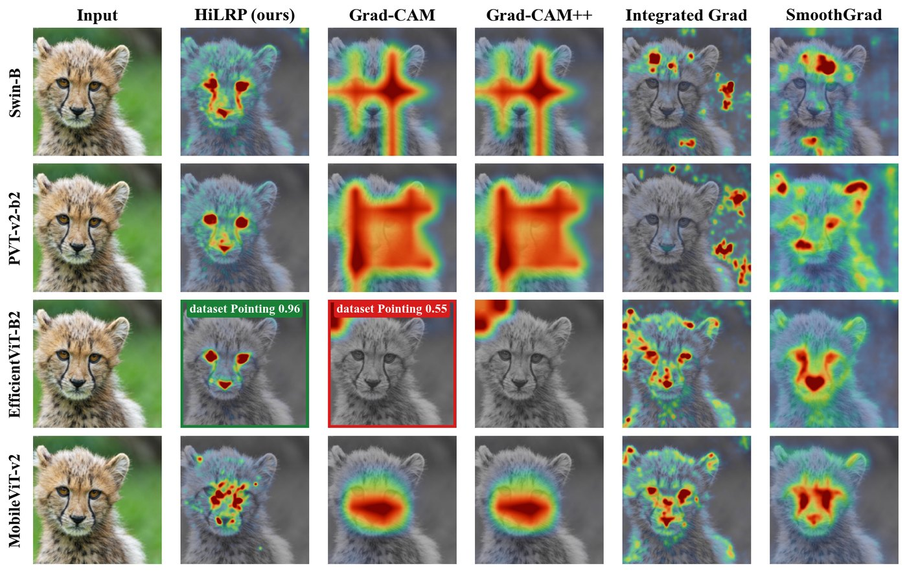
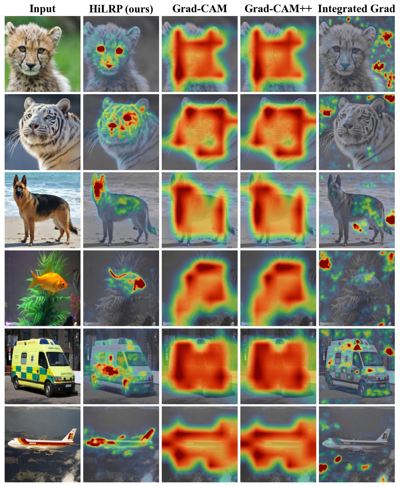
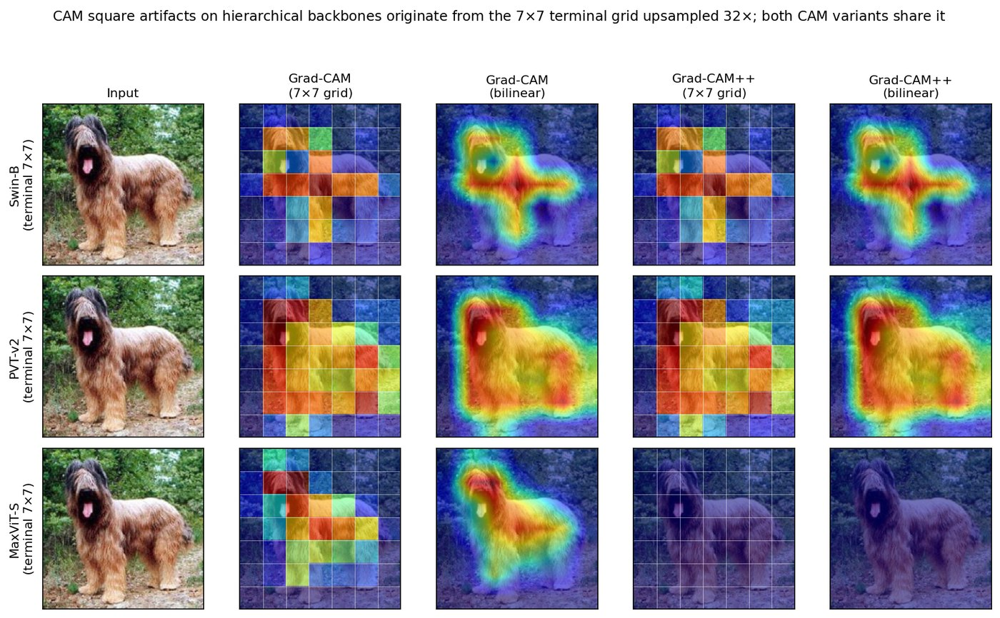
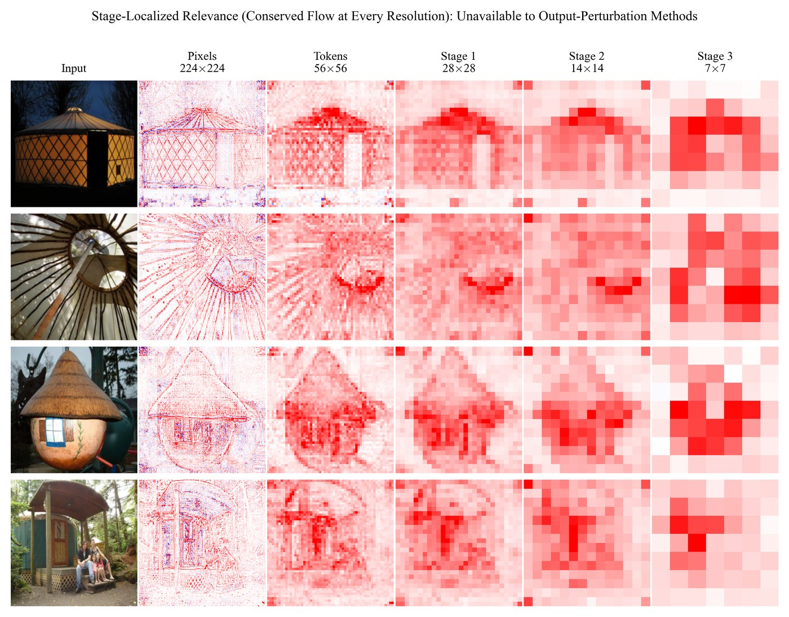
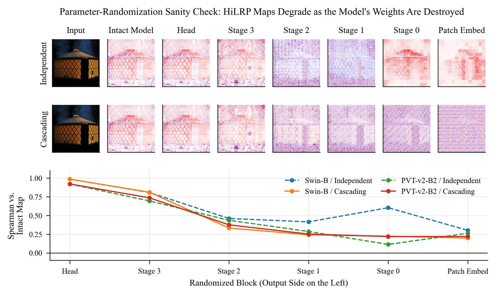
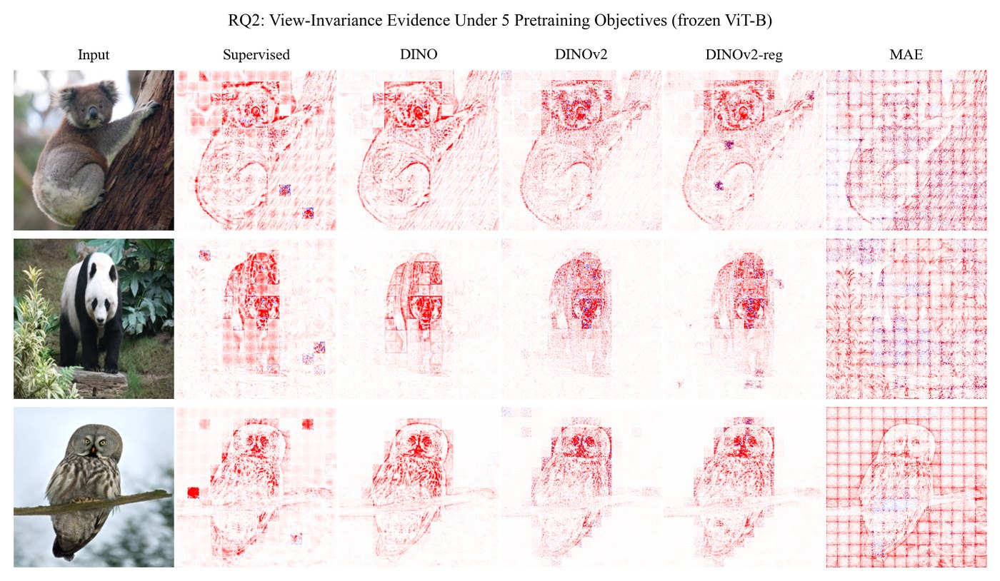
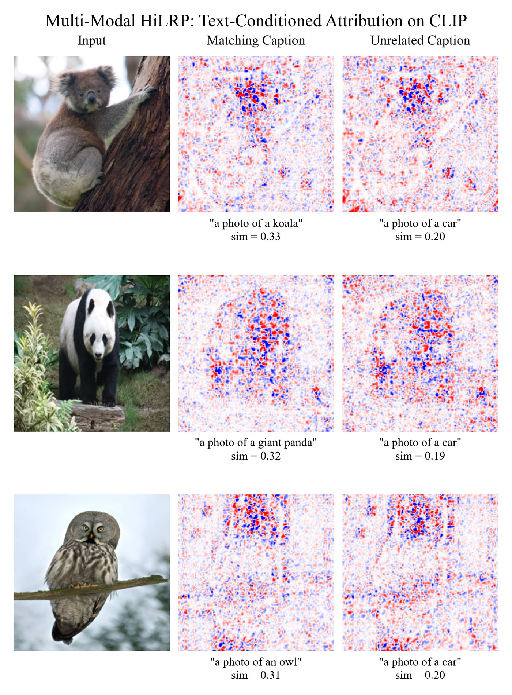

# HiLRP — One Trustworthy Explanation for Any Vision Transformer

**Conservation-valid attribution via attention primitives, plus a controlled 14-method × 10-architecture benchmark of what current XAI does on modern ViTs.**

<p align="left">
  
  
  
  
</p>

<p align="center">
  
</p>

> One image, four backbones, one method that works on all of them. On EfficientViT-B2 the
> linear-attention design removes the terminal spatial feature map that CAM depends on:
> Grad-CAM drops to **0.518** Pointing, _below_ the 0.61 random-point prior, while HiLRP holds
> **0.936** (n = 1000, paired McNemar p = 2 × 10⁻¹⁰⁴).

---

## Why this repository exists

Vision Transformer design has fragmented. Every new backbone recombines convolutional
stems, windowed / linear / multi-axis attention, patch merging, and spatial reduction, and
every recombination breaks a different attribution assumption:

| Method family                        | Structural assumption                           | What breaks it                                           |
| ------------------------------------ | ----------------------------------------------- | -------------------------------------------------------- |
| Grad-CAM, Grad-CAM++                 | a meaningful terminal spatial feature map       | linear cross-covariance attention (EfficientViT)         |
| Attention rollout / flow             | usable global softmax attention over all tokens | windowed, spatial-reduction, multi-axis attention        |
| Captum LRP                           | a hand-derived rule per supported module type   | rejects unsupported modules: **0 rows on timm ViTs**     |
| Perturbation (RISE, LIME, Occlusion) | nothing, but output-level only and expensive    | tells you _that_ a patch mattered, not _where_ it emerged |

This repository contains the two halves of the response:

1. **`xai_bench/methods/hilrp/` — the method.** A conservation-valid attribution framework
   whose map is a _decomposition of the prediction_, not a heuristic saliency score.
2. **`xai_bench/` — the benchmark.** A registry-based harness that ran 14 attribution
   methods across 10 backbones and 5 metric axes, and which motivates the method by
   showing that attribution rankings do not transfer across ViT families.

---

## The core idea: any attention is four conserving primitives

Rather than deriving a new rule for every new architecture, HiLRP decomposes attention and
resolution-reduction into four operation classes. Each admits one relevance rule that
conserves, so a new backbone is covered **by construction rather than by derivation**.

<p align="center">
  
</p>

| #      | Primitive          | Instances                                                 | Rule                                               |
| ------ | ------------------ | --------------------------------------------------------- | -------------------------------------------------- |
| **P1** | Linear map         | Q/K/V/out projections, MLP, conv, pooling, RoPE           | ε / γ rule                                         |
| **P2** | Bilinear mix       | QKᵀ, A·V, linear-attention products, deformable sampling  | uniform split, or CP (detach one factor as a gate) |
| **P3** | Normalize / gate   | softmax, LayerNorm, linear-attention denominator, SE gate | detach the denominator → identity rule             |
| **P4** | Reindex / sparsity | heads, windows, cyclic shifts, dilation, patch merging    | permutation, exact (Lemma 2)                       |

**Lemma 1 (why it conserves).** For a linear layer `yᵢ = Σⱼ wᵢⱼvⱼ` with contributions
`zᵢⱼ = wᵢⱼvⱼ` and denominators `zᵢ = Σⱼ zᵢⱼ`, the rule `R(vⱼ) = Σᵢ (zᵢⱼ/zᵢ) R(yᵢ)` satisfies
`Σⱼ R(vⱼ) = Σᵢ R(yᵢ)`. Conservation is one exchange of summation order.

**Lemma 2 (why shifts and windows are free).** Permutations and coordinate embeddings have
exactly one nonzero `zᵢⱼ` per row, so the ratio is 1 and they conserve _exactly_, with no
ε-leak. Window partitioning, cyclic shifts, and the un-concat regroup are therefore not new
objects requiring new derivations.

### Attention coverage

| Status                                                 | Attention types                                                                                                                                                                        |
| ------------------------------------------------------ | -------------------------------------------------------------------------------------------------------------------------------------------------------------------------------------- |
| **Verified on real pretrained models**                 | self / MHA, windowed + shifted (Swin), spatial-reduction (PVT-v2), linear cross-covariance (EfficientViT), separable (MobileViT-v2), multi-axis (MaxViT), CLIP image-tower cross-modal |
| **Proved conserving in the float64 toy suite** (1e-11) | cross (encoder-decoder), co-attention (bi-modal), channel / coordinate gated, dilated / sparse, deformable (bilinear sampling at learned offsets)                                      |
| **Trivial by construction**                            | grouped / multi-query (broadcast), RoPE / relative position (rotation, additive bias)                                                                                                  |

---

## Headline results

### 1. Localization where CAM's assumption breaks

Paired per-image Pointing Game, same images for every method.

| Backbone                    | Attention type          | HiLRP                    | Grad-CAM             | n    | Paired McNemar   |
| --------------------------- | ----------------------- | ------------------------ | -------------------- | ---- | ---------------- |
| EfficientViT-B2             | linear cross-covariance | **0.936** [0.921, 0.950] | 0.518 [0.486, 0.549] | 1000 | p = 2.1 × 10⁻¹⁰⁴ |
| PVT-v2-b2                   | spatial-reduction       | **0.958** [0.945, 0.970] | 0.846 [0.823, 0.868] | 1000 | p = 1.3 × 10⁻²⁴  |
| EfficientViT-B2 (VOC 2007)  | linear cross-covariance | **0.820** [0.795, 0.843] | 0.582 [0.551, 0.612] | 1000 | p = 3.3 × 10⁻⁴¹  |
| PVT-v2-b2 (VOC 2007)        | spatial-reduction       | **0.865** [0.844, 0.886] | 0.621 [0.591, 0.650] | 1000 | p = 5.7 × 10⁻⁴⁸  |

95% bootstrap CIs (2000 resamples). The gap replicates on a second dataset with a different
annotation type (VOC 2007 detection boxes), so it is not an ImageNet-S artifact.

> **What this is not.** HiLRP does not win every metric on every backbone. Grad-CAM
> saturates the _soft_ bounding-box Pointing metric on Swin and MobileViT (1.00), where this
> eval set has a 0.97 centre-point prior. On those models the HiLRP story is capability
> (conservation, stage maps, defined rules), not a pointing score.

### 2. Conservation is the actual discriminator

Pointing does not separate the top tier. Conservation does. `sum(R)/logit` at the
input-adjacent cut, 100 images:

| Backbone        | Family            | AttnLRP-naive Pointing | AttnLRP-naive conservation     | HiLRP Pointing | HiLRP conservation |
| --------------- | ----------------- | ---------------------- | ------------------------------ | -------------- | ------------------ |
| ViT-B/16        | flat ViT          | 0.770                  | +0.15                          | 0.770          | +0.61              |
| Swin-B          | hierarchical      | 0.980                  | **+3.08 ± 0.78** (inflated 3×) | 0.950          | +0.95              |
| PVT-v2-b2       | spatial-reduction | 0.800                  | **0.00 (zeroed)**              | 0.980          | +0.39              |
| EfficientViT-B2 | linear attention  | 0.930                  | **0.00 (zeroed)**              | 0.960          | traceable          |
| MobileViT-v2    | conv-hybrid       | 0.950                  | **0.00 (zeroed)**              | 0.860          | +1.05 (head)       |

A zero-sum map still has an argmax, so it can "point" convincingly while its region
contributions do not sum to the logit — violating the completeness property that is LRP's
entire justification. On these architectures HiLRP is the only conservation-valid option.
Full discussion: [`docs/lineage_table.md`](docs/lineage_table.md).

### 3. Agreement with axiomatic Shapley values

Our own benchmark showed Faithfulness Correlation is uninformative (|mean| < 0.08 across
every cell, Friedman p = 0.57), so the primary yardstick is sampled permutation Shapley over
SLIC regions — unbiased and axiomatically unique. Mean Spearman agreement, n = 50, m = 64:

| Method               | Swin-T    | PVT-v2-b2 | EfficientViT-B2 |
| -------------------- | --------- | --------- | --------------- |
| **HiLRP**            | **0.528** | **0.531** | **0.417**       |
| Grad-CAM             | 0.515     | 0.449     | 0.077           |
| SmoothGrad           | 0.312     | 0.260     | 0.321           |
| Integrated Gradients | 0.192     | 0.279     | 0.281           |
| Saliency             | 0.214     | 0.137     | 0.240           |

On Swin and PVT, HiLRP and Grad-CAM are statistically indistinguishable (paired Wilcoxon
p = 0.45 on Swin). The separation appears exactly where linear attention removes CAM's
spatial heuristic. Two independently computed yardsticks, one story.

---

## What the maps look like

<p align="center">
  
</p>

HiLRP traces object structure — the cheetah's eyes and muzzle, the ambulance's markings, the
aircraft's engines and tail — where CAM produces a square blob and Integrated Gradients
produces scattered high-frequency noise.

### Why CAM produces those squares

<p align="center">
  
</p>

The blocky structure is not a rendering choice: hierarchical backbones end at a 7×7 terminal
grid, so a CAM map is 49 numbers upsampled 32×. Grad-CAM's high Pointing on Swin and
MobileViT is largely the **dataset centre prior** — a content-free centre-Gaussian blob also
scores 1.00, and Grad-CAM maps correlate 0.72 / 0.63 with that blob, against HiLRP's
0.25 / 0.14.

### Stage-localized relevance

<p align="center">
  
</p>

Because relevance is conserved at every interface, the same backward pass yields a valid map
at _every_ resolution: pixels → 56² tokens → 28² → 14² → 7². Texture becomes parts becomes
object. Output-perturbation methods (ViT-CX, TIS) structurally cannot produce this — they
work at the output level only.

### Sanity check: the maps depend on the weights

<p align="center">
  
</p>

Adebayo-style parameter randomization, independent and cascading. Agreement with the intact
map falls monotonically as weights are destroyed from the head downward — HiLRP is
explaining the model, not the image.

### The same backward pass, no new rules

The two results below required no new relevance rule. A label-free self-supervised scalar
and a cross-modal image-text similarity are just different seeds for the same conserving
backward pass.

**Pretraining objective determines the explanation (RQ2).** Frozen ViT-B, six pretraining
objectives, one common label-free scalar `cos(cls(x), cls(flip(x)))`. Cross-objective map
agreement is **0.36**, not 1.0: the objective, not the architecture, shapes the explanation.
The DINO family reaches 0.97 label-free Pointing with no labels anywhere, and object
emergence replicates across DINO generations; MAE routes ≈ 0 relevance to pixels (0.07),
consistent with a reconstruction objective. This is possible because each model is explained
**in its own objective** instead of through a linear probe.

<p align="center">
  
</p>

**Multi-modal CLIP attribution.** Text-conditioned relevance on the CLIP ViT-B/16 image
tower, scalar = `cos(f_img(x), f_text(caption))` with the text encoder frozen and the cosine
denominator detached. A matching caption concentrates relevance on the object; an unrelated
caption does not. Forward equivalence 1.9 × 10⁻⁶.

<p align="center">
  
</p>

---

## Benchmark: attribution rankings do not transfer

The harness covers 14 methods × 10 architectures
([`benchmark_results/all_results_sofar.csv`](benchmark_results/all_results_sofar.csv) is the
single source of truth). The published benchmark reports the complete-coverage subset:
**13 baseline methods on 8 backbones** across 5 axes (faithfulness, localization, robustness,
complexity, cost), using the community-standard stack unchanged (Quantus, Captum,
`pytorch-grad-cam`) so that the failures reported are properties of _standard practice_, not
of a bespoke setup.

Pointing Game, n = 100. `—` = structurally undefined on that backbone: the toolbox has no
rule for that attention mechanism, and a generic fallback would confound a transfer failure
with a wrong-algorithm artifact.

| Method            | RN-50    | ViT-B/16 | Swin-B   | PVT-v2   | MaxViT-S | MobileViT | EffViT-B1 | EffViT-B2 |
| ----------------- | -------- | -------- | -------- | -------- | -------- | --------- | --------- | --------- |
| Saliency          | 0.82     | 0.65     | 0.62     | 0.62     | 0.58     | 0.90      | 0.86      | 0.66      |
| Integrated Grad   | 0.92     | 0.64     | 0.66     | 0.64     | 0.62     | 0.90      | 0.90      | 0.90      |
| Input×Grad        | 0.86     | 0.64     | 0.67     | 0.66     | 0.56     | 0.88      | 0.74      | 0.64      |
| SmoothGrad        | 0.97     | 0.85     | 0.79     | **0.92** | 0.70     | 0.92      | 0.92      | **0.92**  |
| VarGrad           | **0.98** | 0.76     | 0.71     | 0.88     | 0.68     | 0.90      | 0.90      | **0.92**  |
| GradientSHAP      | 0.92     | 0.70     | 0.73     | 0.70     | 0.65     | 0.88      | 0.86      | 0.84      |
| Grad-CAM          | **0.98** | **0.93** | **1.00** | 0.84     | **1.00** | **1.00**  | 0.70      | 0.55      |
| Grad-CAM++        | 0.97     | 0.49     | **1.00** | 0.88     | 0.80     | **1.00**  | 0.44      | 0.56      |
| Attention Rollout | —        | 0.64     | —        | —        | —        | —         | —         | —         |
| AttnLRP           | —        | 0.83     | —        | —        | —        | —         | —         | —         |
| Occlusion         | 0.95     | 0.76     | 0.78     | 0.78     | 0.66     | 0.92      | **0.96**  | 0.88      |
| RISE              | 0.82     | 0.73     | 0.68     | 0.68     | 0.70     | 0.90      | 0.92      | 0.78      |
| LIME              | 0.94     | 0.87     | 0.86     | 0.86     | 0.80     | 0.90      | 0.80      | 0.90      |

Four findings, each a plank under the method:

1. **Attention-native methods collapse on ViTs.** Rollout scores 0.64 on ViT-B — worse than
   plain gradients — and is undefined on six of the seven ViT variants.
2. **Grad-CAM breaks specifically on linear attention** (EffViT-B1 0.70, B2 0.55), not on
   conv-hybrids generally. On a healthy MobileViT-v2 it scores 1.00.
3. **Faithfulness Correlation does not discriminate.** |mean| < 0.08 with std ≈ 0.22 in every
   cell; the Friedman omnibus test fails outright (p = 0.57). This is why Shapley agreement,
   not deletion AUC, is the primary yardstick above.
4. **Captum LRP does not run at all** on the four timm transformers — 0 rows. That is the
   literal infrastructure gap the method fills.

---

## Installation

Python 3.10+, PyTorch 2.1+, one GPU (CPU works, slower).

```bash
git clone https://github.com/<your-org>/hilrp.git
cd hilrp

pip install -e .                 # core: torch, timm, captum, numpy, pandas, matplotlib
pip install -e ".[extra]"        # quantus metrics, pytorch-grad-cam, networkx
pip install "lxt==2.1"           # required by HiLRP (the `lxt.efficient` backend)
```

**Version notes that matter.** `lxt` must be 2.x — the `lxt.efficient` submodules HiLRP
imports do not exist in 0.6.x. On Windows, `pip install lxt` needs `PYTHONUTF8=1` or the
sdist metadata step hits a charmap `UnicodeDecodeError`. `lxt==2.1` pulls `timm` 1.0.28; the
class-level patches and the cached baselines were validated on **timm 1.0.16**, so re-pin
afterwards if you are reproducing published numbers.

Verify the install by running the conservation suite — these tests _are_ the guarantee:

```bash
python -m pytest xai_bench/methods/hilrp/tests/ -v      # 24 passed
```

## Quickstart

```python
import timm, torch
import matplotlib.pyplot as plt
from xai_bench.methods.hilrp.swin_lxt import attribute_swin
from xai_bench.methods.hilrp.viz import normalize_for_display

model = timm.create_model("swin_tiny_patch4_window7_224", pretrained=True).eval()
x = torch.randn(1, 3, 224, 224)          # your normalized image batch

res = attribute_swin(model, x, target=None, gamma=0.25, attn_mode="cp")

res["pixel_map"]    # [224, 224] signed relevance at input pixels
res["stage_maps"]   # [(name, [h, w]), ...] tokens_56, stage1_in_28, stage2_in_14, ...
res["stage_sums"]   # [(name, sum(R)/logit), ...] the conservation trace

# Always render through the helper: it clips at the 99th percentile of |R|.
heatmap, vmax = normalize_for_display(res["pixel_map"])
plt.imshow(heatmap, cmap="bwr", vmin=-vmax, vmax=vmax)
```

```text
stage_sums: tokens_56 1.11 | stage1_in_28 1.48 | stage2_in_14 1.95 |
            stage3_in_7 1.42 | final_7 1.03        # relevance stays on the logit's scale
```

Other backbones expose the same signature: `pvt_lxt.attribute_pvt`,
`efficientvit_lxt.attribute_efficientvit`, `mobilevit_lxt.attribute_mobilevit`,
`maxvit_lxt.attribute_maxvit`, `vit_lxt.attribute_vit`, `clip_lxt` for CLIP. The bench
dispatches automatically by model name via `xai_bench/methods/hilrp_method.py`.

> **Always render through `viz.normalize_for_display`.** HiLRP maps are heavy-tailed on deep
> conv stems (~27% of |mass| in the top 1% of pixels on MobileViT), so naive symmetric-max
> normalization washes them out and looks like a blank map. The helper applies a
> 99th-percentile clip.

## Running the benchmark

```bash
# 1. Build the ImageNet-S cache (bboxes + labels) once
python scripts/data/cache_imagenets.py --num 1000 --split validation
python scripts/data/cache_voc.py --num 1000               # optional second dataset

# 2. Baselines: any config in configs/
python -m xai_bench.runner --config configs/full_benchmark_100.yaml

# 3. HiLRP rows — MUST be a dedicated run, see the warning below
python -m xai_bench.runner --config configs/hilrp_grid.yaml

# 4. Regenerate paper tables and figures from the merged CSV
python scripts/bench/benchmark_tables.py       # -> paper/results_tables_generated.tex
python scripts/bench/benchmark_figures.py      # -> figures/bench/*.pdf,*.png
python scripts/make_readme_assets.py           # -> docs/assets/*
```

> ⚠️ **HiLRP must run in its own process.** The backend applies _class-level_ forward patches
> (`nn.LayerNorm`, `nn.GELU`, timm attention classes). Forward numerics are unchanged, but
> every other method's **gradients** in the same process are altered by them. Never put
> `hilrp` in a `methods:` list alongside baselines. The same lesson produced the two-pass
> Shapley protocol — contaminated baselines had artificially depressed scores
> (saliency 0.08 → 0.21 honest).

### Reproducing individual results

| Result                                        | Script                                                   |
| --------------------------------------------- | -------------------------------------------------------- |
| Gate 1/2 conservation, stage maps             | `scripts/hilrp/gate2_real_swin.py`                       |
| Pointing game, four architectures             | `scripts/hilrp/gate3_pointing.py`                        |
| n = 1000 scaled eval + bootstrap CI + McNemar | `scripts/bench/scaled_eval.py`                           |
| Shapley agreement (SLIC / SAM segments)       | `scripts/hilrp/shapley_pilot.py`, `gate4_shapley_sam.py` |
| Lineage: naive AttnLRP vs HiLRP               | `scripts/hilrp/lineage_naive_legs.py`                    |
| RQ2 pretraining objectives                    | `scripts/hilrp/rq2_pretraining.py`                       |
| CLIP multi-modal attribution                  | `scripts/hilrp/clip_demo.py`                             |
| Parameter-randomization sanity check          | `scripts/hilrp/sanity_check.py`                          |
| Conditional equivariance                      | `scripts/hilrp/equivariance_test.py`                     |
| γ selection ablation                          | `scripts/hilrp/gamma_selection.py`                       |

All scripts assume the repository root as the working directory.

---

## Repository layout

```
xai_bench/                    the benchmark harness + the method
├── methods/hilrp/            ← THE CONTRIBUTION
│   ├── hierarchical.py         patch merging, shifted windows, un-concat regroup
│   ├── attention_primitives.py the four primitives, float64 reference implementation
│   ├── rules.py                inherited LRP primitives (self-contained, no LXT needed)
│   ├── {swin,pvt,efficientvit,mobilevit,maxvit,vit,clip,crossvit}_lxt.py
│   │                           per-backbone ports on the LXT efficient backend
│   ├── viz.py                  normalize_for_display — use for ALL rendering
│   ├── toy_swin.py             test-only 2-stage reference model
│   └── tests/                  24 conservation / coverage / equivariance tests
├── methods/                  15 baseline attribution methods, registry-registered
├── metrics/                  37 metrics, Quantus-backed
├── models/, datasets/        timm backbones, ImageNet-S / VOC loaders
├── registry.py, runner.py    string-keyed registry + config-driven runner
configs/                      benchmark run configs (dev/ holds smoke tests)
scripts/
├── bench/                    benchmark runs, tables, figures
├── hilrp/                    method gates, ablations, RQ2, CLIP, lineage
├── data/                     dataset cache builders
└── make_readme_assets.py     rebuild docs/assets from figures/
benchmark_results/            all_results_sofar.csv — single source of truth for tables
figures/{bench,hilrp}/        full-resolution paper figures (PNG + PDF)
docs/assets/                  web-optimized copies used by this README
paper/                        LaTeX sources for both manuscripts
notebooks/                    figure reproduction from cached results
```

## Verified numerics

Thresholds are tied to dtype and enforced on every push by
[`.github/workflows/conservation-tests.yml`](.github/workflows/conservation-tests.yml), so a
regression in any relevance rule fails the build instead of silently degrading a published
number.

The CI install is deliberately minimal — CPU `torch`, `torchvision`, `timm`, `numpy`,
`pytest`, nothing else. `rules.py` is self-contained, so the guarantee never comes to depend
on the benchmark stack (`captum`, `quantus`) or the attribution backend (`lxt`, `zennit`).
`xai_bench` records missing optional dependencies rather than raising on import, so
`xai_bench.methods.hilrp` stays importable in a bare environment; ask a registry for an entry
whose module failed to load and it names the missing package instead of reporting an unknown
method. `xai_bench.registration_report()` prints what did and did not register.

| Property                                    | Achieved (float64) | Test ceiling      |
| ------------------------------------------- | ------------------ | ----------------- |
| Patch-merge rule, isolated                  | 3.4 × 10⁻¹⁶        | < 1 × 10⁻¹³       |
| Un-concat regroup + exact inverse           | 0.0                | < 1 × 10⁻¹⁴       |
| Decomposed forward vs timm `PatchMerging`   | 1.1 × 10⁻¹⁵        | < 1 × 10⁻¹⁴       |
| Shifted-window masked-pair relevance leak   | 8 × 10⁻⁴³          | < 1 × 10⁻³⁰       |
| End-to-end 2-stage Swin, bias-free          | 6.5 × 10⁻⁹         | < 1 × 10⁻²        |
| Four-primitive toy suite                    | 1 × 10⁻¹¹          | machine precision |
| _Negative control:_ affine-LN rule leaks    | 1.1                | must be > 0.5     |
| _Negative control:_ naive ε + bias unstable | 6.5 × 10³          | must be > 1.0     |

### Scope of the conservation claim

Conservation is **guaranteed at the token level** and through the proven operations (patch
merge, shift, mask, regroup, pool). It is **approximate at the pixel level**: the γ = 0.25
rule on `Linear`/`Conv2d` and the patch-embed convolution introduce controlled, monotone,
reproducible deviation in exchange for denoising.

Measured on real Swin-T, 20 images: tokens **1.05 ± 0.11**, pixels **0.82 ± 0.08**, final
logit **1.00**.

We do not claim end-to-end pixel-level conservation, and this repository will not print a
number that says otherwise. Conservation is also **necessary but not sufficient**: a passing
conservation check proves no relevance leaked, but wrong token bookkeeping still conserves
numerically while scrambling the spatial map — which is why the qualitative gates exist
alongside the numeric ones.

### Known limitations

- **MobileViT-v2 robustness.** Max-sensitivity is 8.51, against 0.44–1.12 on Swin / PVT /
  EfficientViT. A γ sweep showed this is inherent to the deep separable-conv pixel gradient,
  not a tunable parameter.
- **MobileViT-v2 spatial smearing.** Its `GroupNorm1` normalizes across `(C, H, W)`, so every
  pixel mathematically depends on the background. Conserving honestly means passing relevance
  back through that global mean, which visibly smears the map. Naive AttnLRP looks _prettier_
  there precisely because it fails to patch `GroupNorm1` and destroys conservation
  (sum flips +1.00 → −1.94).
- **Flat CLS-pooled ViTs.** The conserving CP-LRP default scores 0.70 Pointing, above the 0.61
  prior but below the non-conserving `attn_mode='attnlrp'` diagnostic (0.90, |cons−1| 0.39 →
  0.85). We report the conserving number; "points without conserving" is the exact failure the
  paper criticizes, so it stays a labeled diagnostic and never the headline.
- **Equivariance is conditional.** ViTs are not shift-equivariant, and masked Swin has no
  exact input-space translation symmetry. The theorem states: _if_ the forward commutes with a
  token/pixel permutation, HiLRP commutes. Empirically, at equal forward drift, HiLRP
  consistency is ≈ 0.90 against saliency's 0.41–0.61.

---

## Relation to prior work

HiLRP **inherits** AttnLRP's stabilized block-internal rules (softmax Taylor, bilinear split,
LayerNorm) rather than reimplementing attention internals, and adds the primitive
decomposition, the resolution-reduction rules, and the guards that stop silent failure.

- **AttnLRP** (Achtibat et al., 2024) fixes block-internal ops for _flat_ transformers. We
  inherit those and supply what does not exist there: rules for hierarchical and hybrid
  operations. On flat ViT-B this is **parity with the lineage** (0.770 vs 0.770), not a win.
- **Chefer et al. (2021), GenAtt** — gradient × relevance for flat ViTs. Baselines and
  lineage, not competition; no defined rules for hierarchical operations.
- **ViT-CX, TIS, C2F-Explainer** — output-level perturbation. They tell you _that_ a patch
  mattered; stage-localized relevance tells you _where in the network_ it emerged. A
  different axis, not a faithfulness-score arms race.
- **DynamicLRP** (2025) argues that hand-deriving a rule per module type is unsustainable.
  That critique, in someone else's words, is exactly the opening the four-primitive
  decomposition closes.
- **DINO emergent attention maps** are a property of the SSL representation, not an XAI
  method — and are structurally unavailable for Swin (no CLS token, windowed attention). Used
  here as a baseline and probe in RQ2.

## Manuscripts

Two manuscripts are built from this code. Their LaTeX sources live in `paper/` and are not
distributed while under review; the results they report are reproducible from the scripts
and configs above.

| Manuscript              | Content                                                                                                             |
| ----------------------- | ------------------------------------------------------------------------------------------------------------------- |
| **Method paper**        | _Toward One Trustworthy Explanation for Any Vision Transformer: Conservation-Valid Attribution via Attention Primitives_ |
| **Benchmark paper**     | The controlled cross-architecture attribution benchmark and the metric critique behind Section "Benchmark" above     |
| `paper/hilrp_theory.tex` | Proofs: Lemma 1, Lemma 2, the unifying proposition, conditional equivariance                                        |

Supporting artifacts that _are_ tracked: the lineage comparison
([`docs/lineage_table.md`](docs/lineage_table.md)), the benchmark source of truth
([`benchmark_results/`](benchmark_results/)), and every figure in
[`figures/`](figures/). Build the manuscripts with `latexmk -pdf paper/paper.tex` from the
repository root (`\graphicspath` resolves `figures/` from either location).

## Citation

```bibtex
@article{sathiyamohan2026hilrp,
  title   = {Toward One Trustworthy Explanation for Any Vision Transformer:
             Conservation-Valid Attribution via Attention Primitives},
  author  = {Sathiyamohan, Nishankar},
  journal = {Under review},
  year    = {2026}
}
```

## License

MIT — see [`LICENSE`](LICENSE). Model weights come from `timm` and carry their own licenses;
ImageNet-S and PASCAL VOC 2007 are subject to their respective terms.

## Acknowledgements

Built on [LXT/AttnLRP](https://github.com/rachtibat/LRP-eXplains-Transformers),
[zennit](https://github.com/chr5tphr/zennit), [timm](https://github.com/huggingface/pytorch-image-models),
[Quantus](https://github.com/understandable-machine-intelligence-lab/Quantus), and
[Captum](https://github.com/pytorch/captum). No model was fine-tuned: every result uses
frozen, publicly released checkpoints.
