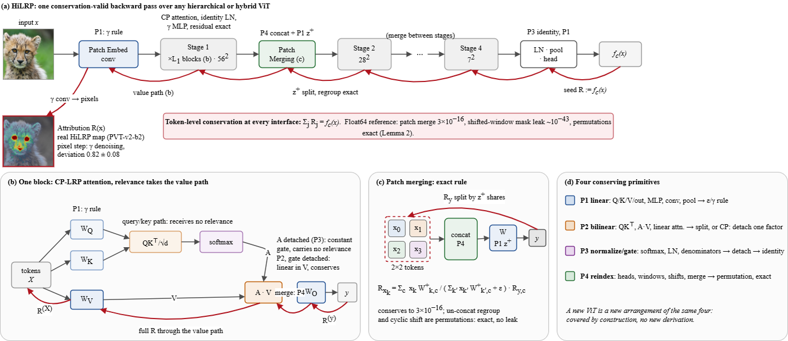

# HiLRP: method

The [README](../README.md) gives the idea in one paragraph. This is the longer version:
the four primitives, why each rule conserves, and which attention mechanisms are covered.
For what conservation does and does not guarantee on trained models, see
[RESULTS.md](RESULTS.md#limitations).

**The key technical idea.** Rather than deriving a new rule per architecture, decompose
attention and resolution reduction into four operation classes. Each has one conserving rule,
so any arrangement of them, present or future, is covered.

  

| # | Primitive | Instances | Rule |
|---|---|---|---|
| P1 | Linear map | Q/K/V/out projections, MLP, conv, pooling, RoPE | epsilon / gamma rule |
| P2 | Bilinear mix | QKᵀ, A·V, linear-attention products, deformable sampling | uniform split, or CP (detach one factor as a gate) |
| P3 | Normalize / gate | softmax, LayerNorm, linear-attention denominator, SE gate | detach the denominator, identity rule |
| P4 | Reindex / sparsity | heads, windows, cyclic shifts, dilation, patch merging | permutation, exact (Lemma 2) |

**Lemma 1, why it conserves.** For a linear layer `yᵢ = Σⱼ wᵢⱼvⱼ` with contributions
`zᵢⱼ = wᵢⱼvⱼ` and denominators `zᵢ = Σⱼ zᵢⱼ`, the rule `R(vⱼ) = Σᵢ (zᵢⱼ/zᵢ) R(yᵢ)` satisfies
`Σⱼ R(vⱼ) = Σᵢ R(yᵢ)`. Conservation is one exchange of summation order.

**Lemma 2, why shifts and windows are free.** Permutations and coordinate embeddings have
exactly one nonzero `zᵢⱼ` per row, so the ratio is 1 and they conserve exactly, with no
epsilon leak. Window partitioning, cyclic shifts, and the un-concat regroup are therefore not
new objects requiring new derivations.

**Attention coverage.**

| Status | Attention types |
|---|---|
| Verified on real pretrained models | self / MHA, windowed and shifted (Swin), spatial-reduction (PVT-v2), linear cross-covariance (EfficientViT), separable (MobileViT-v2), multi-axis (MaxViT), CLIP image-tower cross-modal |
| Proved conserving in the float64 toy suite (1e-11) | cross (encoder-decoder), co-attention (bi-modal), channel / coordinate gated, dilated / sparse, deformable (bilinear sampling at learned offsets) |
| Trivial by construction | grouped / multi-query (broadcast), RoPE and relative position (rotation, additive bias) |
